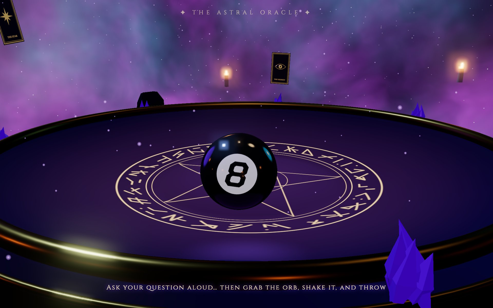
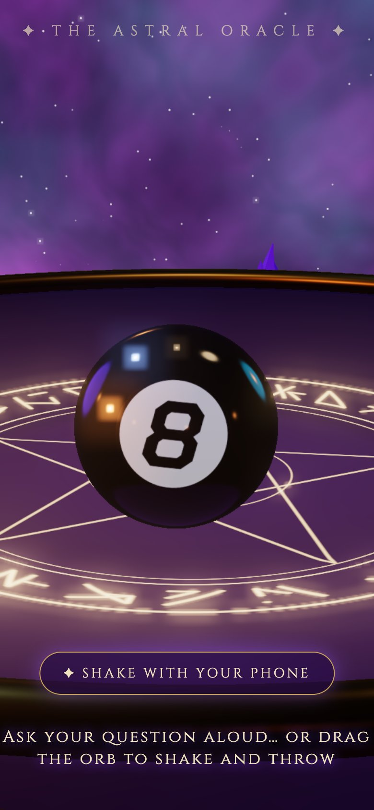
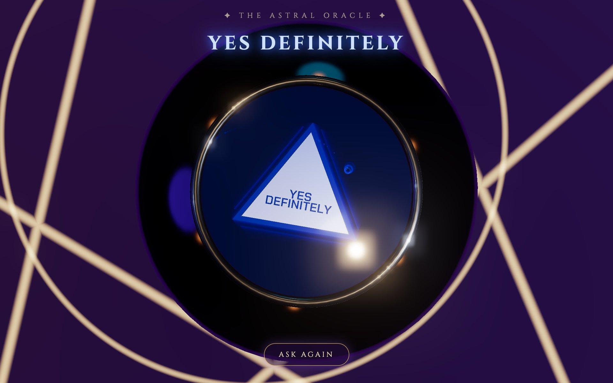
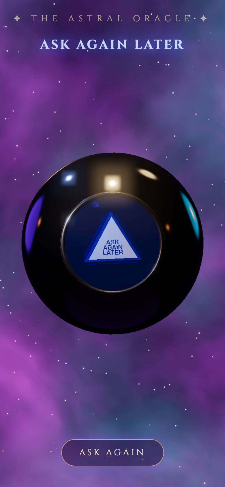

# eightball.lol

**Play it: [eightball.lol](https://eightball.lol)**

A Magic 8 Ball you can actually throw. Grab it, shake it, fling it across the astral séance table,
and watch the die float up through the liquid with your answer. On a phone, tap
**✦ Shake with your phone** and shake the phone itself like the real toy.

| Desktop | Phone |
|---|---|
|  |  |
|  |  |

Built with Three.js and no build step: plain ES modules, with Three.js and the die's font served from this repo.

- **Custom physics**: a bottom-weighted ball that rights itself on a dish-shaped table.
- **Liquid**: a simulated flow field with buoyancy, drag and Beer–Lambert light absorption.
- **The die**: a real 3D icosahedron with the answers cut into the faces (Chakra Petch).
- **Handheld mode**: on phones, the device's motion shakes the liquid (iOS asks for motion permission over https).
- **Secret links**: [eightball.lol/make](https://eightball.lol/make) creates a link with your own message carved into the die.

## How it was built

I built this with [Claude Code](https://claude.com/claude-code), Anthropic's AI coding agent. Claude Code
wrote the code; I directed it as the product owner, deciding what to build, testing every version on my phone
and in desktop browsers, and turning what felt wrong into the next change. It took about 15 rounds of changes.

The product calls that shaped it:

- **Phone first:** on a phone the table disappears and you shake the device itself, like the real toy.
  It takes at least five shakes, then you hold still for the answer.
- **Permission flow:** iOS only lets a page read motion after a tap, so shaking starts from a clear
  "Shake with your phone" button instead of a prompt that appears out of nowhere.
- **Load time:** the first version sat on a black screen for about 30 seconds in iOS Safari. Self-hosting
  Three.js, pre-baking the font data and drawing a lighter scene on phones got the first frame under half a
  second in desktop and simulated-phone tests.
- **Built to share:** secret links that fix the answer, and `/make` for a custom message carved into the die.
- **Found by testing:** Firefox stuck on the loading screen, Go home not resetting a custom link, and the
  answer taking 6 to 7 seconds to appear after shaking (now about 2).

## Run locally

```sh
python3 server.py   # http://localhost:8080
```

## Deploy

`render.yaml` deploys it as a static site on Render (New → Blueprint), on the eightball.lol custom domain.

## License

MIT (see [LICENSE](LICENSE)). Three.js is MIT ([vendor/three/LICENSE](vendor/three/LICENSE)); the Chakra Petch
glyph data in `fonts/` is under the SIL Open Font License ([fonts/OFL.txt](fonts/OFL.txt)).

A fan project, not affiliated with Mattel. Magic 8 Ball is a trademark of Mattel, Inc.
